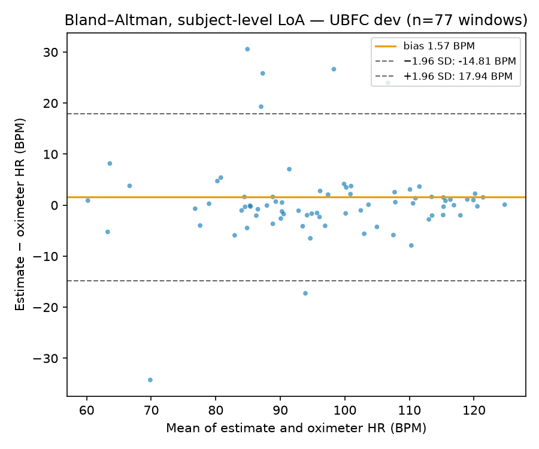
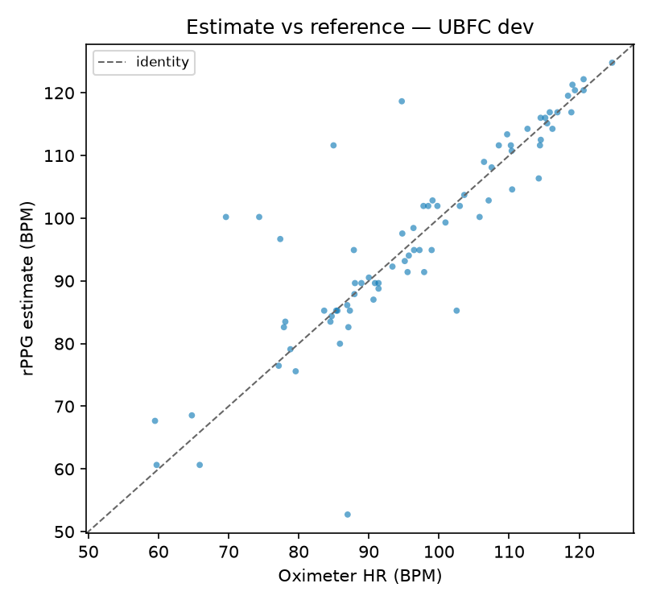
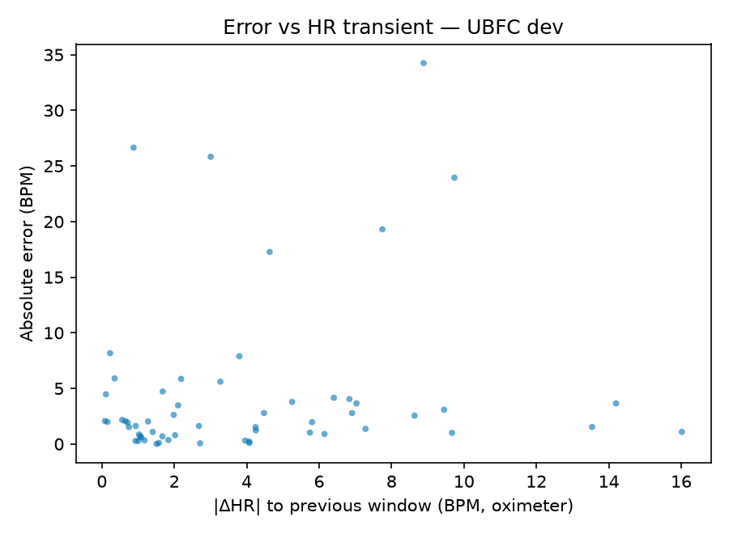

# UBFC REALISTIC evaluation — dev split

- Windows: 80 across 21 subjects; seed 20261204; params: `params_frozen.json`
- Constant baseline: 96.8 BPM (development mean)

| Method | MAE (BPM) [95% CI] | RMSE (BPM) [95% CI] | r [Fisher 95% CI] | Coverage | Failure >10 BPM |
|---|---|---|---|---|---|
| POS (pipeline) | 4.50 [2.54, 7.16] | 8.39 [3.87, 11.99] | 0.858 [0.785, 0.908] | 96.2% | 9.1% |
| Green channel | 4.30 [2.34, 7.28] | 7.57 [3.26, 12.10] | 0.902 [0.803, 0.953] | 37.5% | 6.7% |
| Constant guess | 12.67 [9.50, 16.29] | 15.39 [11.66, 19.15] | nan [nan, nan] | 100.0% | 56.2% |

Bland–Altman (subject-level): bias 1.57 BPM, LoA [-14.81, 17.94] BPM (21 subjects).
Worst-case MAE (abstentions imputed 10 BPM): 4.71 BPM.
Paired MAE difference vs constant: -8.26 BPM [-12.26, -4.35] (negative = pipeline better).

Figures (data table = results/windows CSV):
- 
- 
- 

- stratum_motion_flag_0: n=60, MAE 4.24 BPM, coverage 96.7%
- stratum_motion_flag_1: n=20, MAE 5.31 BPM, coverage 95.0%
- stratum_low_light_flag_0: n=60, MAE 3.71 BPM, coverage 95.0%
- stratum_low_light_flag_1: n=20, MAE 6.76 BPM, coverage 100.0%

Abstentions:
{
 "low_quality": 3
}
