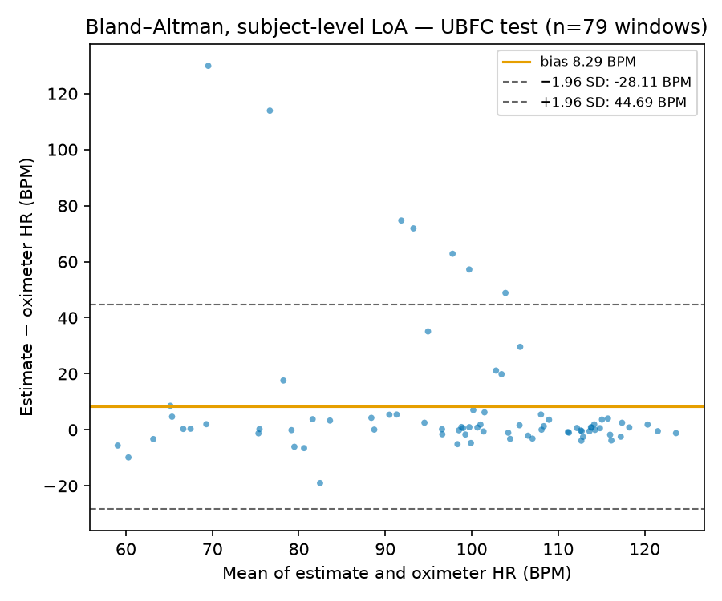
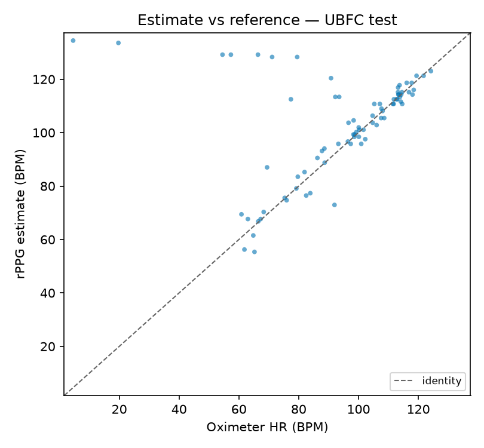
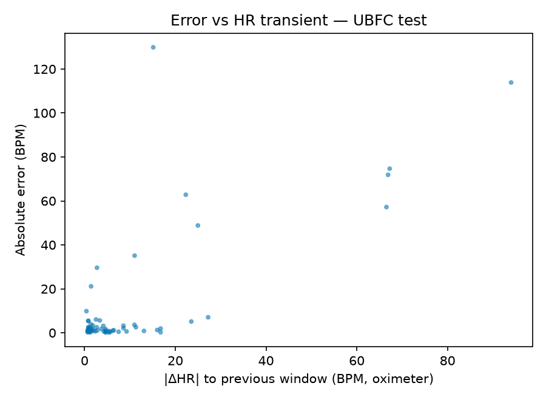

# UBFC REALISTIC evaluation — test split

- Windows: 82 across 21 subjects; seed 20261204; params: `params_frozen.json`
- Constant baseline: 96.8 BPM (development mean)

| Method | MAE (BPM) [95% CI] | RMSE (BPM) [95% CI] | r [Fisher 95% CI] | Coverage | Failure >10 BPM |
|---|---|---|---|---|---|
| POS (pipeline) | 10.96 [4.68, 19.65] | 26.28 [10.26, 40.22] | 0.288 [0.071, 0.478] | 96.3% | 16.5% |
| Green channel | 12.82 [4.56, 23.81] | 26.98 [7.84, 42.32] | 0.383 [0.089, 0.615] | 51.2% | 23.8% |
| Constant guess | 17.02 [12.45, 22.15] | 22.46 [15.28, 30.12] | nan [nan, nan] | 100.0% | 67.1% |

Bland–Altman (subject-level): bias 8.29 BPM, LoA [-28.11, 44.69] BPM (21 subjects).
Worst-case MAE (abstentions imputed 10 BPM): 10.93 BPM.
Paired MAE difference vs constant: -6.18 BPM [-11.44, -0.69] (negative = pipeline better).

Figures (data table = results/windows CSV):
- 
- 
- 

- stratum_motion_flag_0: n=48, MAE 5.55 BPM, coverage 97.9%
- stratum_motion_flag_1: n=34, MAE 18.91 BPM, coverage 94.1%
- stratum_low_light_flag_0: n=55, MAE 11.35 BPM, coverage 96.4%
- stratum_low_light_flag_1: n=27, MAE 10.18 BPM, coverage 96.3%

Abstentions:
{
 "low_quality": 3
}
